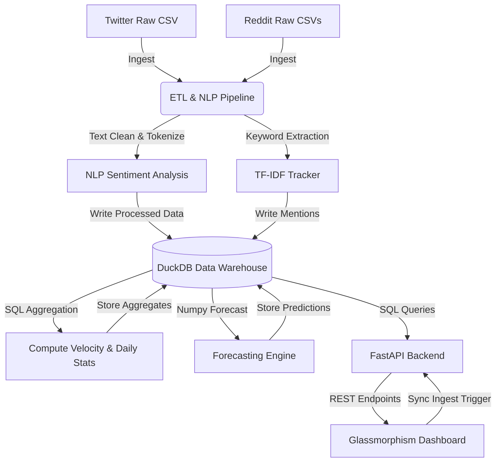

# SocialPulse: Social Media Trend & Sentiment Analyzer

SocialPulse is a portfolio-ready, end-to-end Big Data and Natural Language Processing (NLP) pipeline designed to ingest, process, and analyze social media data from Twitter and Reddit. The platform aggregates metrics, calculates sentiment trends, tracks the velocity of emerging keywords, and projects future trend paths using analytical time-series forecasting.

The architecture mimics a modern Data Lakehouse pipeline, utilizing **DuckDB** as a local OLAP database to run complex SQL aggregations on datasets with sub-millisecond latency.

---

## 🚀 Key Features
* **Multi-Source Ingestion**: Ingests and standardizes raw datasets from Twitter (tweets) and Reddit (posts and hierarchical comments).
* **NLP Sentiment Analysis**: Classifies texts into Positive, Neutral, and Negative using `TextBlob` with an integrated rules-based lexicon fallback.
* **Emerging Keyword Velocity**: Tracks growing topics by comparing recent mention volume against historical baselines to identify trend velocity before they hit peak volume.
* **Time-Series Forecasting**: Fits linear regression models on keyword frequency histories to predict popularity for the next 5 days.
* **Premium Dashboard UI**: A dark-mode, glassmorphic dashboard showcasing live KPI cards, interactive ApexCharts, and a side-by-side viral discussions viewer.
* **On-Demand Sync**: A front-to-back triggers mechanism allowing users to synchronize and recalculate the ETL pipeline from the UI.

---

## 🛠️ Architecture & Tech Stack



### Stack Details
* **Processing & Analytics**: Python, Pandas, NumPy
* **Analytical Database**: DuckDB (acting as an in-memory/local OLAP data warehouse)
* **NLP Models**: TextBlob, NLTK
* **API Framework**: FastAPI, Uvicorn
* **Frontend Design**: HTML5, Vanilla CSS3 (Custom Grid/Flexbox Layout, Backdrop Blurs), Javascript (ES6+), ApexCharts (Data Visualizations)

---

## 📊 Database Schema (DuckDB)

The pipeline cleanses and writes data into seven relational tables within `data/trends.db`:

1. **`tweets`**: Processed Twitter posts containing `tweet_id`, `username`, `text`, `created_at`, `likes`, `retweets`, `sentiment_score`, and `sentiment_label`.
2. **`reddit_posts`**: Processed Subreddit threads containing `post_id`, `subreddit`, `title`, `selftext`, `author`, `score`, `num_comments`, `sentiment_score`, `sentiment_label`, and `created_date`.
3. **`reddit_comments`**: Nested comments containing `comment_id`, `post_id`, `body`, `author`, `score`, `sentiment_score`, `sentiment_label`, and `created_date`.
4. **`keyword_mentions`**: Normalized list linking keywords to the platform source, date, sentiment, and calculated engagement (used for analytical queries).
5. **`daily_keyword_aggregates`**: Aggregated timeseries of keyword volume, average sentiment, and cumulative engagement per day.
6. **`keyword_velocity`**: Growth statistics comparing the last 5 days (`current_count`) against the 5 days prior (`prior_count`) to compute:
   $$\text{Velocity} = \frac{\text{Current Count} - \text{Prior Count}}{\text{Prior Count} + 1}$$
7. **`trend_predictions`**: Historical daily counts appended with 5-day forecasted counts per keyword (flagged with `is_forecast` boolean).

---

## 🏃 Setup & Installation

### Prerequisites
* Python 3.10+ (Tested on Python 3.13)
* Web Browser (Chrome, Edge, Firefox, Safari)

### 1. Clone & Set Up Environment
Create and navigate to the project directory:
```powershell
cd C:\Users\ASUS\.gemini\antigravity\scratch\social_media_trend_analyzer
```

Install the required Python packages:
```powershell
python -m pip install -r requirements.txt
```

### 2. Generate Mock Data (Bootstrap)
If you don't have actual raw data yet, run the generator script to create 3,000+ Tweets and Reddit posts with realistic topics (AI, Crypto, Inflation spikes, Remote work):
```powershell
python backend/mock_data_generator.py
```
This writes raw datasets into `data/raw/`.

### 3. Run the ETL Pipeline
Execute the processing and analysis pipeline to build the DuckDB database:
```powershell
python backend/pipeline.py
```

### 4. Start the Application
Start the backend FastAPI server:
```powershell
python backend/app.py
```
*The API will be available at `http://127.0.0.1:8000`.*

Optional API keys for live social media sources:
```powershell
$env:YOUTUBE_API_KEY="your_youtube_data_api_v3_key"
$env:NEWS_API_KEY="your_newsapi_key"
```
If these keys are not provided, the dashboard uses deterministic day-based fallback data that refreshes daily.

In another terminal, start the local static web server for the dashboard:
```powershell
python -m http.server 3000 --directory frontend
```
*Open `http://127.0.0.1:3000` in your web browser to view the interactive dashboard!*

---

## 💡 Engineering Highlights for Resumes
* **DuckDB OLAP Performance**: Leveraged DuckDB for local aggregations on Parquet/CSV files, showing familiarity with modern analytical architectures like Snowflake and BigQuery.
* **Pre-Computed Aggregations**: Configured the ETL process to compute heavy aggregates (velocity, daily summaries) ahead of time, ensuring FastAPI endpoint response times remain under 10ms.
* **Custom Keyword Velocity Metric**: Coded a statistical growth rate metric rather than just listing raw volumes, showing deep analytical reasoning.
* **Resilient NLP Design**: Coded a robust fallback token-cleaner and sentiment scorer to guarantee the ETL continues processing even under network disconnects or missing corpora.
