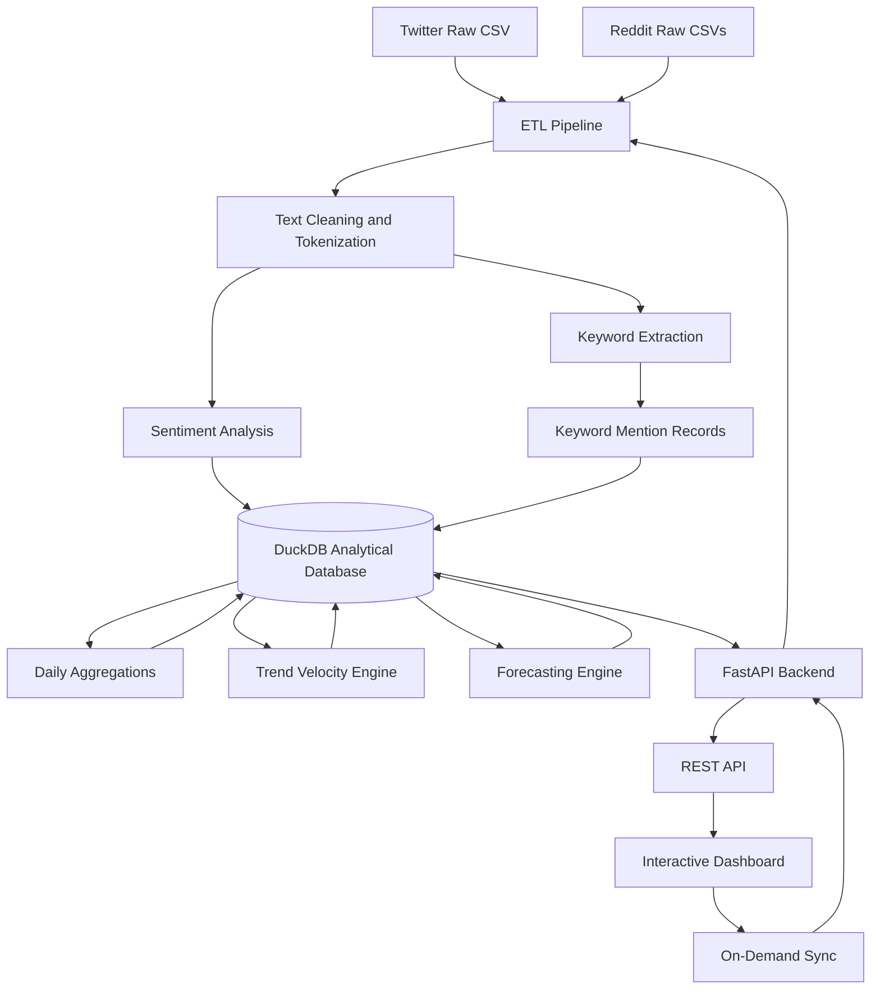

# SocialPulse — Social Media Trend & Sentiment Analyzer

**An end-to-end Big Data analytics platform for social media sentiment analysis, emerging trend detection, and time-series forecasting.**

SocialPulse is a data engineering and NLP project that transforms raw social media data into actionable insights. It processes Twitter and Reddit datasets through an ETL pipeline, performs sentiment classification and keyword extraction, identifies emerging trends using a custom velocity metric, and forecasts keyword popularity for the next five days.

Built with **Python, DuckDB, Pandas, NumPy, FastAPI, and ApexCharts**, SocialPulse combines an analytical data pipeline with an interactive dashboard to demonstrate modern data processing and visualization techniques.

**Repository:** [AKSHATT18/SOCIAL-MEDIA-TREND-ANALYZER](https://github.com/AKSHATT18/SOCIAL-MEDIA-TREND-ANALYZER)

---

## Table of Contents

- [Overview](#overview)
- [Key Features](#key-features)
- [System Architecture](#system-architecture)
- [Technology Stack](#technology-stack)
- [Data Pipeline](#data-pipeline)
- [Database Schema](#database-schema)
- [Project Structure](#project-structure)
- [Installation and Setup](#installation-and-setup)
- [Running the Application](#running-the-application)
- [API Overview](#api-overview)
- [Analytics Methodology](#analytics-methodology)
- [Engineering Highlights](#engineering-highlights)
- [Future Improvements](#future-improvements)
- [Author](#author)

---

## Overview

Social media platforms generate enormous volumes of unstructured textual data. Extracting meaningful information from this data requires reliable ingestion, text processing, analytical storage, and efficient visualization.

SocialPulse addresses this challenge through an end-to-end pipeline that:

- Processes social media posts and discussions from multiple sources.
- Cleans and standardizes unstructured text.
- Classifies content into positive, neutral, and negative sentiment categories.
- Extracts keywords and tracks their frequency over time.
- Identifies rapidly growing topics using historical comparisons.
- Forecasts keyword popularity using linear regression.
- Stores processed data and analytical results in DuckDB.
- Presents insights through an interactive, dark-themed dashboard.

The project demonstrates practical concepts in **ETL engineering, analytical SQL, NLP, time-series analysis, REST API development, and dashboard design**.

## Key Features

### 1. Multi-Source Data Ingestion

Processes datasets from Twitter and Reddit, including posts, threads, and hierarchical comments.

- Standardizes records from different sources.
- Handles missing values and inconsistent fields.
- Converts timestamps into a consistent format.
- Preserves platform-specific engagement metrics.
- Supports reproducible local development through synthetic data generation.

### 2. NLP-Based Sentiment Analysis

Analyzes textual content to determine its overall sentiment.

- Classifies text as positive, neutral, or negative.
- Uses TextBlob for sentiment scoring.
- Includes a rules-based lexicon fallback for resilient processing.
- Supports sentiment aggregation across keywords, platforms, and time periods.

### 3. Keyword Extraction and Tracking

Identifies frequently occurring topics and tracks their activity over time.

- Cleans and tokenizes text.
- Extracts relevant keywords.
- Associates keyword mentions with dates, platforms, sentiment, and engagement.
- Tracks daily mention volumes.
- Enables historical analysis of emerging discussions.

TF-IDF-based keyword tracking is used to support topic analysis and identify relevant terms within the processed corpus.

### 4. Emerging Trend Detection

Calculates keyword velocity by comparing recent activity with an earlier historical baseline.

The system compares the latest five-day mention count against the preceding five-day period to identify topics experiencing increased attention.

This helps distinguish rapidly growing discussions from topics that are simply popular overall.

### 5. Time-Series Forecasting

Uses NumPy-based linear regression to estimate future keyword popularity.

- Builds historical keyword-frequency series.
- Fits a linear trend to historical observations.
- Generates five-day forecasts.
- Stores historical and predicted values for visualization.

The forecasts provide a simple statistical baseline rather than a guarantee of future social media activity.

### 6. Analytical Storage with DuckDB

Uses DuckDB as a local analytical database for processed records and precomputed metrics.

- Stores cleaned social media data.
- Executes SQL-based analytical queries.
- Maintains daily keyword aggregates.
- Stores trend velocity metrics and forecast results.
- Reduces repeated computation for dashboard requests.

### 7. Interactive Analytics Dashboard

Provides a centralized interface for exploring trends and sentiment.

- Dark-themed interface with glassmorphism-inspired styling.
- KPI cards for key analytical metrics.
- Interactive charts powered by ApexCharts.
- Sentiment and keyword trend visualizations.
- Side-by-side viral discussion views.
- On-demand synchronization to trigger pipeline updates.

---

## System Architecture

The application follows a modular data processing architecture that separates ingestion, NLP processing, analytical storage, API delivery, and visualization.



### Architecture Components

| Component | Responsibility |
|---|---|
| Data Ingestion | Loads and standardizes raw Twitter and Reddit datasets. |
| ETL Pipeline | Cleans records, normalizes fields, and prepares analytical data. |
| NLP Engine | Calculates sentiment and extracts relevant keywords. |
| DuckDB | Stores processed data, aggregates, trend metrics, and predictions. |
| Analytics Engine | Computes keyword growth, daily statistics, and forecasts. |
| FastAPI | Exposes processed analytics through REST endpoints. |
| Frontend Dashboard | Visualizes KPIs, sentiment, keyword activity, and discussions. |
| Sync Mechanism | Initiates backend processing and refreshes analytical results. |

---

## Technology Stack

| Category | Technologies |
|---|---|
| Programming Language | Python |
| Data Processing | Pandas, NumPy |
| Analytical Database | DuckDB |
| Natural Language Processing | TextBlob, NLTK |
| Keyword Analysis | TF-IDF-based tracking |
| Forecasting | Linear Regression |
| Backend Framework | FastAPI |
| ASGI Server | Uvicorn |
| Frontend | HTML5, CSS3, JavaScript ES6+ |
| Data Visualization | ApexCharts |
| Data Sources | Twitter and Reddit CSV datasets |
| Development Environment | Python 3.10+ |

---

## Data Pipeline

The pipeline consists of five primary stages.

### Stage 1: Ingestion

Raw datasets are loaded from the project's data directory.

Supported input categories include:

- Twitter posts.
- Reddit posts.
- Reddit comments.

The ingestion layer standardizes source-specific fields into a consistent representation for downstream processing.

### Stage 2: Data Cleaning and NLP

The processing layer prepares text for analysis.

Typical operations include:

- Handling missing or invalid values.
- Normalizing text.
- Tokenizing content.
- Removing irrelevant tokens where appropriate.
- Calculating sentiment scores.
- Assigning sentiment labels.
- Extracting keywords.

A fallback sentiment-scoring mechanism improves resilience when the primary analysis method cannot produce a result.

### Stage 3: Analytical Data Storage

Processed records are written to DuckDB.

The database stores source-level records alongside normalized keyword mentions and precomputed analytical outputs.

This separation supports both detailed record inspection and efficient aggregate queries.

### Stage 4: Trend Analytics and Forecasting

The analytics layer computes:

- Daily keyword frequencies.
- Average sentiment by keyword and date.
- Engagement metrics.
- Keyword velocity.
- Five-day keyword-frequency forecasts.

The results are stored in analytical tables so the API can retrieve precomputed values instead of recalculating every metric for every dashboard request.

### Stage 5: API and Visualization

FastAPI exposes the analytical results to the frontend.

The dashboard displays aggregated metrics, time-series charts, sentiment distributions, emerging topics, and social media discussions.

Users can also trigger synchronization through the interface to initiate backend processing.

---

## Database Schema

The project uses seven logical tables in `data/trends.db`.

| Table | Purpose |
|---|---|
| `tweets` | Stores processed Twitter posts, engagement metrics, timestamps, and sentiment. |
| `reddit_posts` | Stores Reddit submissions, subreddit details, engagement metrics, and sentiment. |
| `reddit_comments` | Stores processed Reddit comments with their parent post references and sentiment. |
| `keyword_mentions` | Records normalized keyword mentions with source, date, sentiment, and engagement. |
| `daily_keyword_aggregates` | Stores daily keyword counts, average sentiment, and engagement aggregates. |
| `keyword_velocity` | Stores recent and historical mention counts and calculated growth metrics. |
| `trend_predictions` | Stores historical keyword counts and forecasted values. |

### Example: Keyword Velocity

Keyword velocity measures the relative change in mention volume between two time windows.

The project uses the following formula:

\[
\text{Velocity} =
\frac{\text{Current Count} - \text{Prior Count}}
{\text{Prior Count} + 1}
\]

Where:

- **Current Count:** Keyword mentions during the latest five-day window.
- **Prior Count:** Keyword mentions during the preceding five-day window.
- **+1:** A smoothing adjustment that prevents division by zero when the prior count is zero.

**Interpretation:**

- Positive velocity indicates increasing mention volume.
- Negative velocity indicates declining mention volume.
- A value near zero indicates relatively stable activity.

The metric is a custom growth indicator. It should be interpreted alongside absolute mention counts because a small number of mentions can produce a high relative growth rate.

---

## Project Structure

The following is a representative layout of the application:

```text
SOCIAL-MEDIA-TREND-ANALYZER/
│
├── backend/
│   ├── app.py
│   ├── pipeline.py
│   └── mock_data_generator.py
│
├── frontend/
│   ├── index.html
│   ├── styles.css
│   ├── script.js
│   └── ...
│
├── data/
│   ├── raw/
│   └── trends.db
│
├── requirements.txt
└── README.md
```

*Note: The layout above is illustrative. Adjust it to match the actual files and directories in your repository.*

---

## Installation and Setup

### Prerequisites

Ensure the following are installed:

- Python 3.10 or later.
- Git.
- A modern web browser.
- A terminal such as PowerShell, Command Prompt, or Bash.

### Step 1: Clone the Repository

Open a terminal and run:

```bash
git clone https://github.com/AKSHATT18/SOCIAL-MEDIA-TREND-ANALYZER.git
```

Navigate to the project directory:

```bash
cd SOCIAL-MEDIA-TREND-ANALYZER
```

### Step 2: Create a Virtual Environment

On Windows:

```powershell
python -m venv .venv
```

Activate the environment:

```powershell
.venv\Scripts\Activate.ps1
```

If you are using Command Prompt instead of PowerShell:

```bat
.venv\Scripts\activate.bat
```

### Step 3: Install Dependencies

Install the required packages:

```bash
python -m pip install --upgrade pip
python -m pip install -r requirements.txt
```

If NLTK resources are required by your implementation, ensure the necessary resources are available before running the pipeline.

### Step 4: Generate Sample Data

If raw datasets are unavailable, generate synthetic data:

```bash
python backend/mock_data_generator.py
```

The generator is designed to create sample Twitter and Reddit data covering topics such as AI, cryptocurrency, inflation, and remote work.

Generated datasets are written to `data/raw/`.

### Step 5: Run the ETL Pipeline

Execute the processing pipeline:

```bash
python backend/pipeline.py
```

This step processes the raw datasets and builds or updates the DuckDB analytical database.

### Step 6: Start the Backend

Run the FastAPI application:

```bash
python backend/app.py
```

The backend is expected to be available at:

`http://127.0.0.1:8000`

If the application does not start the server automatically, use the following command, provided `app.py` exposes an `app` FastAPI instance:

```bash
python -m uvicorn backend.app:app --reload --host 127.0.0.1 --port 8000
```

### Step 7: Start the Frontend

Open a second terminal from the project root:

```bash
python -m http.server 3000 --directory frontend
```

Open the dashboard in your browser:

`http://127.0.0.1:3000`

**Important:** Ensure the frontend's API configuration points to the correct backend address and port.

### Step 8: Verify the Application

After starting both services:

1. Open the dashboard.
2. Confirm that KPI cards and charts load.
3. Check that the backend can read the DuckDB database.
4. Verify that keyword and sentiment data are displayed.
5. Test the synchronization action, if enabled.

---

## API Overview

The backend uses FastAPI to provide a REST interface between the analytical database and the frontend.

Depending on the endpoints implemented in `backend/app.py`, the API can serve functionality such as:

| API Capability | Description |
|---|---|
| Dashboard Metrics | Returns aggregated KPIs for the dashboard. |
| Sentiment Analytics | Returns sentiment distributions and trends. |
| Keyword Analytics | Returns keyword frequencies and historical activity. |
| Emerging Trends | Returns keywords ranked by velocity. |
| Forecast Data | Returns historical counts and predicted keyword frequencies. |
| Discussion Data | Returns relevant social media posts and discussions. |
| Pipeline Synchronization | Initiates data processing and analytical refreshes. |

To inspect the actual endpoints, start the backend and visit:

- **Swagger UI:** `http://127.0.0.1:8000/docs`
- **ReDoc:** `http://127.0.0.1:8000/redoc`

*The table describes API capabilities rather than guaranteeing specific endpoint paths. Refer to the FastAPI implementation for the actual routes.*

---

## Analytics Methodology

### Sentiment Classification

TextBlob provides polarity-based sentiment scoring, which the pipeline maps to positive, neutral, and negative categories.

The fallback mechanism provides an alternative when primary scoring cannot produce a result.

Sentiment analysis is approximate and may not reliably interpret sarcasm, irony, slang, or context-dependent expressions.

### Keyword Velocity

Keyword velocity compares two consecutive five-day windows to quantify changes in topic activity.

Unlike absolute frequency, this metric emphasizes the **rate at which attention is growing or declining**.

### Linear Regression Forecasting

The forecasting component fits a linear regression model to historical keyword frequencies.

For a keyword with historical counts \(y\) over time \(t\), the model estimates:

\[
\hat{y}_t = \beta_0 + \beta_1 t
\]

Where:

- \(\hat{y}_t\) is the predicted keyword frequency.
- \(\beta_0\) is the intercept.
- \(\beta_1\) is the estimated trend slope.
- \(t\) represents the time index.

The model extrapolates the estimated trend over the next five days.

Because social media activity can change abruptly, these forecasts are best treated as exploratory estimates rather than precise predictions.

---

## Engineering Highlights

### Analytical Query Processing

Uses DuckDB to execute SQL aggregations over structured social media data, supporting local analytical workloads without requiring a separate database server.

### Precomputed Metrics

Calculates daily aggregates, keyword velocity, and forecasts during pipeline processing to reduce repeated work during dashboard requests.

### Custom Trend Detection

Implements a growth metric that compares recent keyword activity with an earlier historical baseline.

### Resilient Text Processing

Combines primary sentiment analysis with a rules-based fallback to improve processing continuity.

### Modular Application Design

Separates data processing, analytical storage, API delivery, and frontend visualization into distinct components.

### End-to-End Data Workflow

Connects ingestion, transformation, NLP, analytical SQL, forecasting, API integration, and dashboard visualization into one application.

---

## Future Improvements

Potential extensions include:

- **Streaming ingestion:** Integrate Apache Kafka to process incoming social media events.
- **Distributed processing:** Use Apache Spark for larger datasets and distributed transformations.
- **Advanced sentiment models:** Evaluate transformer-based models such as BERT for improved contextual understanding.
- **Improved forecasting:** Compare linear regression with ARIMA, Prophet, or other time-series models.
- **Trend anomaly detection:** Detect sudden increases in keyword volume using statistical thresholds.
- **Platform integrations:** Add supported APIs for additional data sources.
- **Automated testing:** Expand unit and integration tests for ingestion, analytics, and API endpoints.
- **Deployment:** Containerize the application with Docker and deploy the dashboard and backend.
- **Monitoring:** Add structured logging, pipeline execution metrics, and failure reporting.

These improvements could extend the project from a local analytics demonstration into a more scalable data engineering platform.

---

## Author

**Akshat Upadhyay**

Computer Science and Engineering | Big Data

GitHub: [@AKSHATT18](https://github.com/AKSHATT18)

### Project Repository

Explore the source code, implementation, and future updates:

**[SocialPulse — Social Media Trend & Sentiment Analyzer](https://github.com/AKSHATT18/SOCIAL-MEDIA-TREND-ANALYZER)**

---

*SocialPulse demonstrates an end-to-end approach to social media analytics by combining data engineering, natural language processing, analytical SQL, statistical forecasting, and interactive visualization.*
